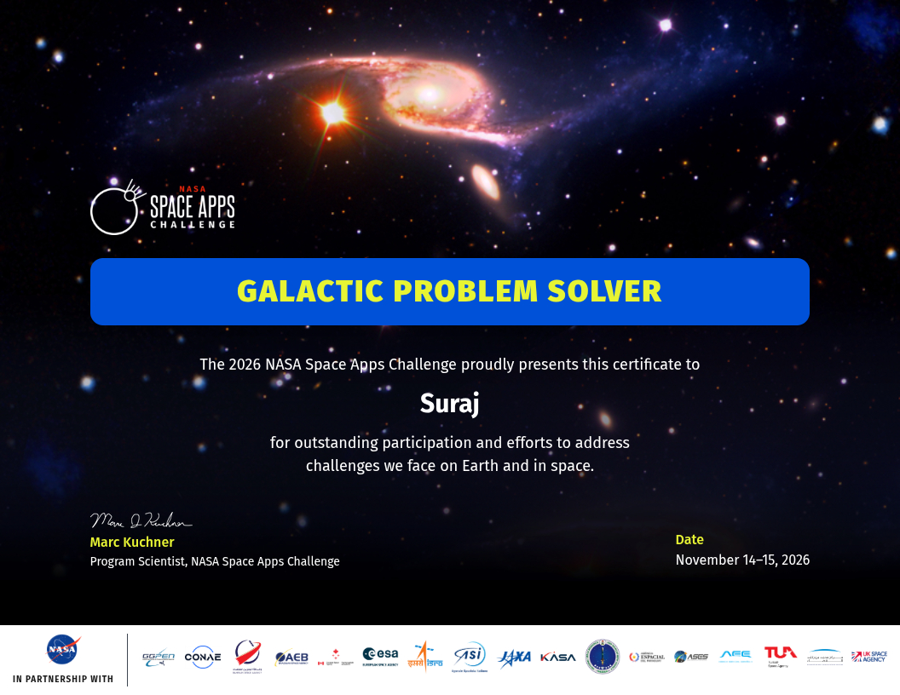

<p align="center">
  
</p>

<p align="center">
  
</p>

## Demo

[](https://www.youtube.com/watch?v=C6mv-IneAUM&t=7s)


<h1 align="center">Terraformers</h1>

Demo - https://terraformers.netlify.app

Motivated by Transformers and their famous slogan - Autobots Re-unite by Optimus Prime.

Google Drive Link of BluePrint - https://drive.google.com/drive/folders/1-ESAb_DRuL0XJXbfHcwrXe-pG2FGNoCs?usp=sharing

Terraformers  is an interactive 3D educational simulation that demonstrates how autonomous, self-assembling swarm robots could prepare the infrastructure required for a future human settlement on Mars.
How it works: Players progress through seven mission chapters, starting with resource collection and robotic component assembly, followed by launch preparation, Mars arrival, autonomous deployment, solar power generation, charging infrastructure, maintenance, and the final vision of a human-ready Mars colony. Interactive challenges, 3D environments, animated sequences, physics simulations, and mission reports make the experience engaging and educational.
Benefits and intended impact: The project introduces students aged 9–15 to robotics, aerospace engineering, physics, renewable energy, resource management, and planetary science. Its intended impact is to inspire young learners to explore STEM fields and think creatively about sustainable space exploration.
Technology used: The application was developed using React, TypeScript, Vite, Three.js, and JavaScript. Blender was used to create 3D models and mission animations. Additional technologies include HTML, CSS, physics simulation tools, and NASA's educational resources and archived Mars weather data. The project is currently a software simulation rather than a deployed physical robot system.
Creativity and design considerations: Its creative approach combines swarm robotics, modular construction, autonomous systems, and storytelling into a playable Mars-colonization experience. Key considerations included scientific plausibility, educational accessibility, mission sequencing, environmental constraints, resource efficiency, renewable power, user engagement, and the technical feasibility of the simulation.

A browser-based, classroom-oriented space exploration game for learners aged 9–15. The app combines the original Terraformers mission campaign with a real-time WebGL planetary scene, conceptual physics experiments and a teacher-facing demo dashboard.

## Run locally

Requirements: Node.js 20 LTS (18.18+ should also work) and npm.

```bash
npm install
npm run dev
```

Open the local URL printed by Vite (normally `http://localhost:5173`).

# Future Scope and Planned Implementations

I intend to expand Terraformers beyond its current educational simulation into a more comprehensive, accessible and collaborative STEM learning platform. The following features represent my proposed development roadmap, which I wish to implement progressively using the existing project as a baseline.

## 1. Expanded Student Experience

I plan to retain the original seven-chapter Terraformers campaign while introducing additional interactive learning capabilities.

- **Interactive 3D planetary exploration:** I want to develop a richer 3D environment where students can explore planetary surfaces, orbit the camera, drive rovers, deploy habitats and interact with simulated infrastructure. I also intend to provide a fallback experience for devices that do not support WebGL.
- **Five planetary destinations:** I plan to expand exploration to the Moon, Mars, Earth, Venus and Jupiter, incorporating planetary characteristics and gravity comparisons. Jupiter will be represented accurately as a gas giant without a solid surface for landing.
- **Advanced physics playground:** I intend to introduce interactive experiments covering rocket thrust, gravity, rover movement, momentum, solar energy, heat transfer, insulation, orbital concepts and structural loads.
- **Age-adaptive learning:** I want to provide different explanations, challenges and learning pathways for students aged 9–11, 12–13 and 14–15.
- **Accessibility:** I plan to improve keyboard navigation, touch controls, visible labels, reduced-motion support and usability across different screen sizes.

## 2. Teacher Command Centre

I envision a dedicated teacher dashboard that will eventually allow educators to:

- Monitor student progress and mission completion.
- Identify concepts where learners may need additional support.
- Create and distribute mission assignments.
- Review learning evidence and class-level progress.
- Present lessons using a classroom-friendly presentation mode.
- Export learning reports in CSV format.

I also intend to replace the current fictional demonstration data with a properly authenticated, school-managed student data system.

## 3. Automated Testing and Reliability

I plan to expand automated testing to cover physics calculations, mission progression, learning outcomes, teacher dashboard functionality and application reliability. My goal is to establish a repeatable testing process that helps ensure new features do not break existing functionality.

## 4. More Advanced 3D and Physics Simulation

I intend to develop the visual and simulation engine further using Three.js and cannon-es. Planned improvements include:

- More detailed planetary environments, terrain and rover models.
- Improved rover movement, suspension and interaction with uneven terrain.
- More realistic habitat assembly and deployment animations.
- Interactive solar arrays, charging stations and robotic infrastructure.
- Adaptive graphics quality for different hardware capabilities.
- Improved planetary environments and mission-specific visual effects.

These improvements will progressively move the experience beyond simplified educational demonstrations while maintaining clear distinctions between conceptual physics models and scientifically validated engineering simulations.

## 5. Collaborative Learning and Production Infrastructure

A major long-term objective is to make Terraformers useful to schools and learning communities.

I intend to develop:
- Secure student, teacher and school administrator accounts.
- School and classroom management.
- Persistent student progress and assignment records.
- Teacher-controlled mission assignments and learning reports.
- Secure cloud-based data storage and synchronization.
- Role-based access, privacy controls and appropriate safeguards for minors.

I plan to use server-side authentication and authorization, tenant isolation, secure APIs and appropriate data-retention policies before introducing real student information.

## 6. Scientific Learning and External Resources

I also wish to expand the integration of educational resources and planetary science information, including NASA datasets, Mars exploration resources and archived weather observations. Future development may include more interactive data visualizations and educational explanations of real planetary conditions.

## 7. Scientific Accuracy, Safety and Educational Integrity

Throughout development, I intend to distinguish between real scientific principles, simplified educational models and fictional mission scenarios. The project is designed as a conceptual learning environment, not a flight-ready engineering simulator. I will continue improving the scientific accuracy of its educational content while ensuring that students understand the limitations of the simulations.

## Long-Term Vision

My ultimate ambition is to transform Terraformers into an open-ended, collaborative STEM learning environment where students can experiment with robotics, planetary exploration, renewable energy, autonomous construction and the engineering challenges of establishing human settlements beyond Earth.

I see the current project as the foundation for this larger vision. I intend to implement these capabilities incrementally, learn from educators and students, and build a platform that makes ambitious space exploration concepts understandable, interactive and inspiring for the next generation.

